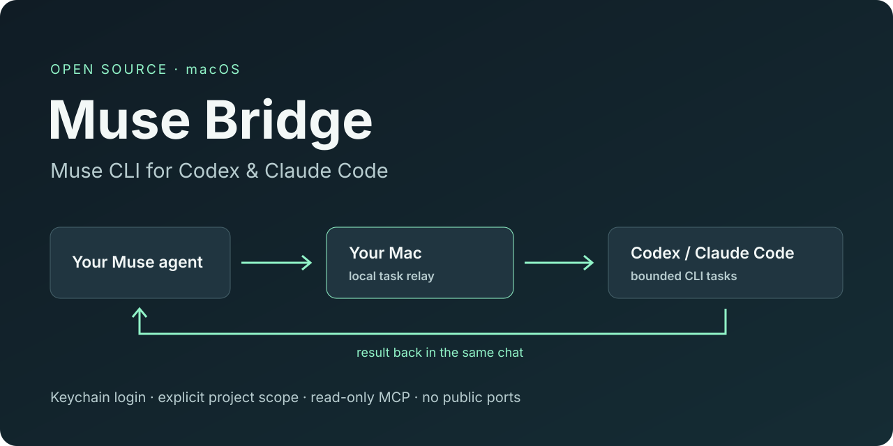
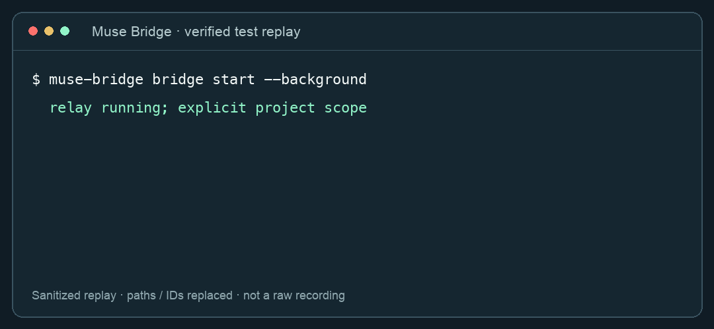

# Muse Bridge — Muse CLI for Codex & Claude Code

**Give your muse.ai personal agent a path to your local coding tools.**

Muse Bridge is an independent, open-source **Muse CLI** for macOS. Read chats, goals and ideas from the terminal, expose read-only MCP tools, or let Muse request a bounded Codex / Claude Code task and get the result back in the same chat.



[Quick start](#quick-start) · [中文说明](README.zh-CN.md) · [Task bridge](TASK_BRIDGE.md) · [Validation](VALIDATION.md) · [Security boundaries](SECURITY.md) · [Protocol provenance](PROVENANCE.md)

> **macOS / Python 3.11+ / experimental internal API.** This connects the muse.ai personal agent. It is not the official Muse Code CLI and is not affiliated with Meta, OpenAI or Anthropic.

## What you can do

| Workflow | Example |
|---|---|
| Read Muse from a terminal | `muse-bridge history --limit 5` |
| Query goals, ideas and feed | `muse-bridge goals` / `ideas` / `feed` |
| Send a message deliberately | `muse-bridge send "Hello" --allow-write` |
| Let an MCP client read Muse | `muse-bridge mcp` |
| Let Muse ask Codex or Claude to work | `muse-bridge bridge start --background` |
| Check or stop the relay | `muse-bridge bridge status` / `bridge stop` |

The task bridge is **bidirectional**:

```text
You ask Muse for a local task
       ↓
Muse emits a structured request in its chat
       ↓
Your Mac polls that chat → Codex or Claude Code CLI
       ↓
A bounded final result returns to the same Muse chat
```

No public inbound port, reverse tunnel or remote shell endpoint is required. The Mac must stay awake, connected and running the relay.

## Quick start

Install [uv](https://docs.astral.sh/uv/getting-started/installation/) and Python 3.11 or later. Install and sign in to Codex and/or Claude Code if you want the task bridge. Google Chrome in `/Applications` is used for a dedicated manual Muse login.

From the GitHub release:

```bash
uv tool install https://github.com/buzhidaosm/muse-cli-bridge/releases/download/v0.3.0/muse_bridge_cli-0.3.0-py3-none-any.whl
muse-bridge doctor
muse-bridge login
muse-bridge identity
```

Or install from source:

```bash
git clone https://github.com/buzhidaosm/muse-cli-bridge.git
cd muse-cli-bridge
uv tool install .
```

`login` opens a separate, temporary Chrome window. Complete your login yourself. A validated session is stored in the **macOS Keychain**; your existing browser profile is not read. Do not paste passwords, cookies or bearer tokens into issues. A manual cookie import fallback is described in [authentication](docs/authentication.md).

### Let Muse use a project

Authorize one project locally first. Start in read mode:

```bash
muse-bridge bridge init --project /absolute/path/to/your/project
muse-bridge bridge start --background
muse-bridge bridge notify
```

`notify` sends the protocol instructions to Muse. In **that same Muse chat**, ask:

> Use Codex to review `/absolute/path/to/your/project` through Muse Bridge. Don't change files. Wait for the local result before summarizing it.

To allow edits, stop the relay and explicitly opt in:

```bash
muse-bridge bridge stop
muse-bridge bridge init --project /absolute/path/to/your/project --allow-write
muse-bridge bridge start --background
muse-bridge bridge notify
```

Repeat `--project` to authorize additional projects. `--all-projects` is a separate, explicit broad-access option. See [the task guide](TASK_BRIDGE.md) before enabling it. Project selection and write permission are checked again immediately before a queued task executes.

## Terminal commands

```bash
muse-bridge status                      # HTTPS login + VM assignment; not a gateway test
muse-bridge identity                    # authenticated gateway query
muse-bridge threads
muse-bridge history --limit 10
muse-bridge history --thread SESSION_ID --limit 10
muse-bridge goals
muse-bridge ideas
muse-bridge feed --limit 10
muse-bridge send "Hello" --allow-write --timeout 60
muse-bridge bridge status
muse-bridge bridge job TASK_ID
muse-bridge bridge stop
muse-bridge logout                      # remove local credentials; does not revoke server session
```

Normal CLI commands return one JSON object. Help/version output is plain text. `mcp` uses stdio JSON-RPC. Sends and local agent tasks are not automatically retried; an ambiguous delivery is reported as `unknown` instead of claimed as success.

## MCP integration

The MCP server exposes seven **read-only** tools: status, identity, threads, history, goals, ideas and feed. It does not expose sending or local execution.

```json
{
  "mcpServers": {
    "muse-bridge": {
      "command": "/absolute/path/to/muse-bridge",
      "args": ["mcp"]
    }
  }
}
```

`command -v muse-bridge` gives the executable path. Authenticated responses are external data, not instructions for the calling agent.

## Tested, with limits

Real-account validation confirmed both directions for Codex and Claude Code: Muse produced task requests, the local agents returned the expected result, and the returned result was independently found in Muse history. Both agents also edited separate disposable test projects, and their final file contents were checked. See [the dated validation record](VALIDATION.md) and [sanitized example evidence](examples/verified-roundtrips.json).



*This is a replay of verified test events with paths and identifiers replaced, not an unedited recording or a fabricated conversation.*

The OS boundary limits **writes**, not all reads or network access. Runtime state and temporary directories are additionally writable. This is not a general computer-use sandbox. Do not use tasks for credentials or data you do not want to send to AI services. [Read the full boundary](SECURITY.md).

Current limits:

- macOS only; standard NON_TEE / legacy Noise handshakes only.
- No desktop clicking or injection into an existing Codex/Claude desktop conversation.
- One selected Muse chat, sequential jobs, no automatic login/startup service.
- No claim that a completed agent process proves an arbitrary task was solved.
- Internal Muse endpoints can change; no official OAuth integration or API stability guarantee.

## Development

```bash
uv sync --no-editable --group dev
uv run --no-editable pytest -q
uv run --no-editable ruff check src tests
uv build
```

After editing source, reinstall the local noneditable package when testing CLI behavior: `uv sync --no-editable --reinstall-package muse-bridge-cli`. Tests import the current `src/` tree directly. Automated tests never require a Muse account; live smoke tests are opt-in.

## Original implementation and contributions

The code, wire codec, relay, executor adapters and tests were independently written. Research consulted public protocol notes and descriptor fields from another client, with attribution in [PROVENANCE.md](PROVENANCE.md). This is not claimed to be a clean-room implementation, and it does not depend on or vendor that client's source.

Useful contributions include reproducible compatibility reports, redacted failure cases, tests and onboarding improvements. Start with [CONTRIBUTING.md](CONTRIBUTING.md). If this makes your workflow easier, a GitHub star helps other developers discover it. Please don't star-swap or buy engagement.

MIT licensed. Canonical repository: [buzhidaosm/muse-cli-bridge](https://github.com/buzhidaosm/muse-cli-bridge).
